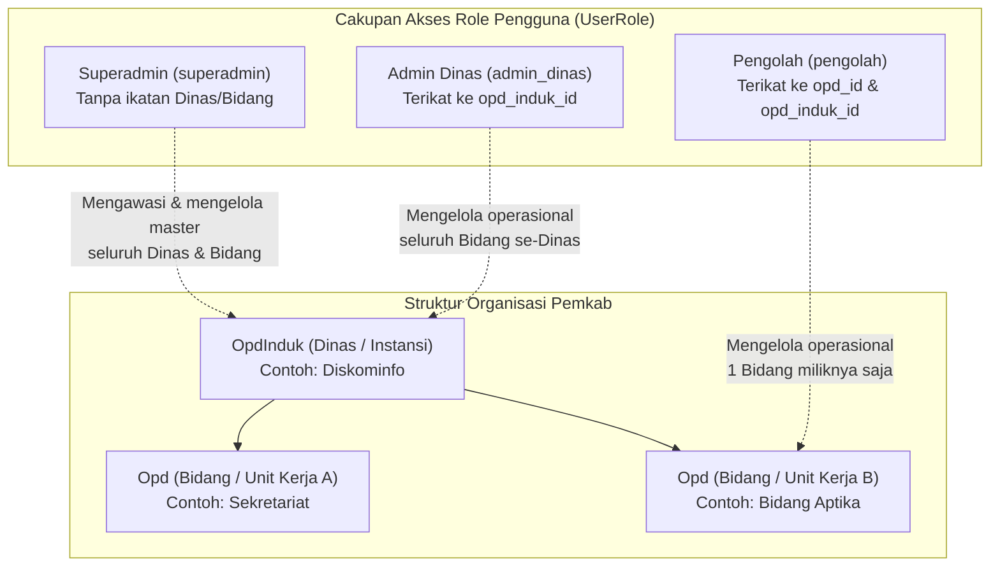
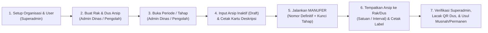
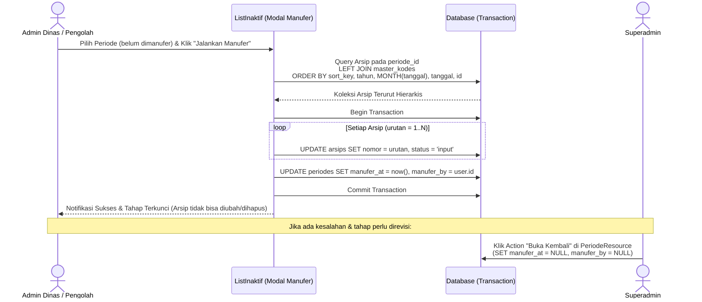
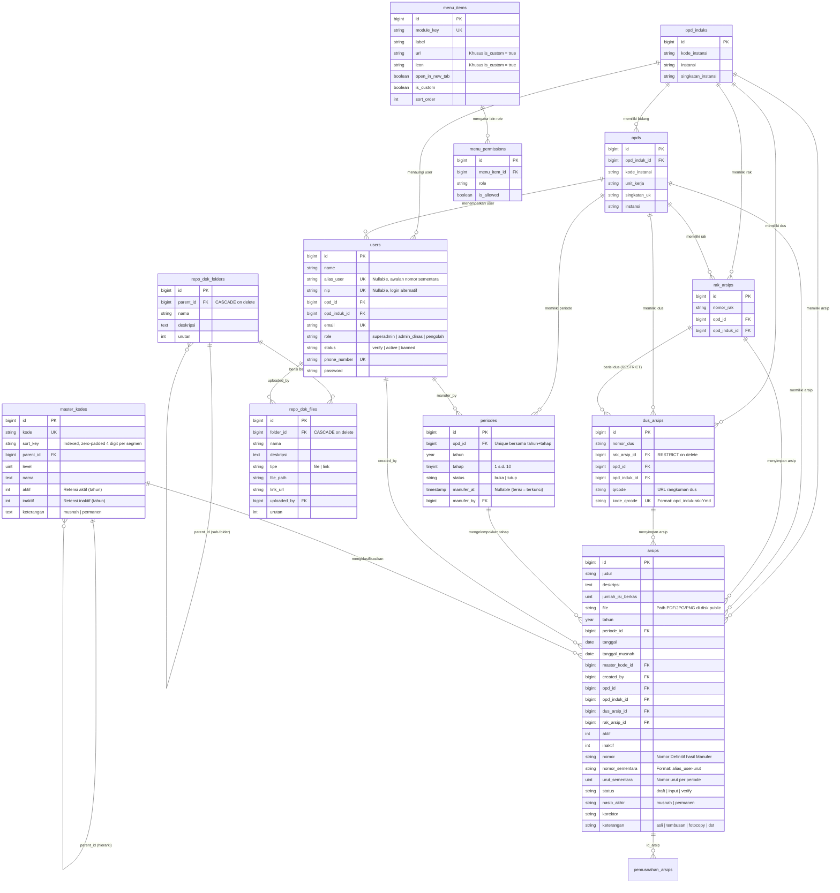
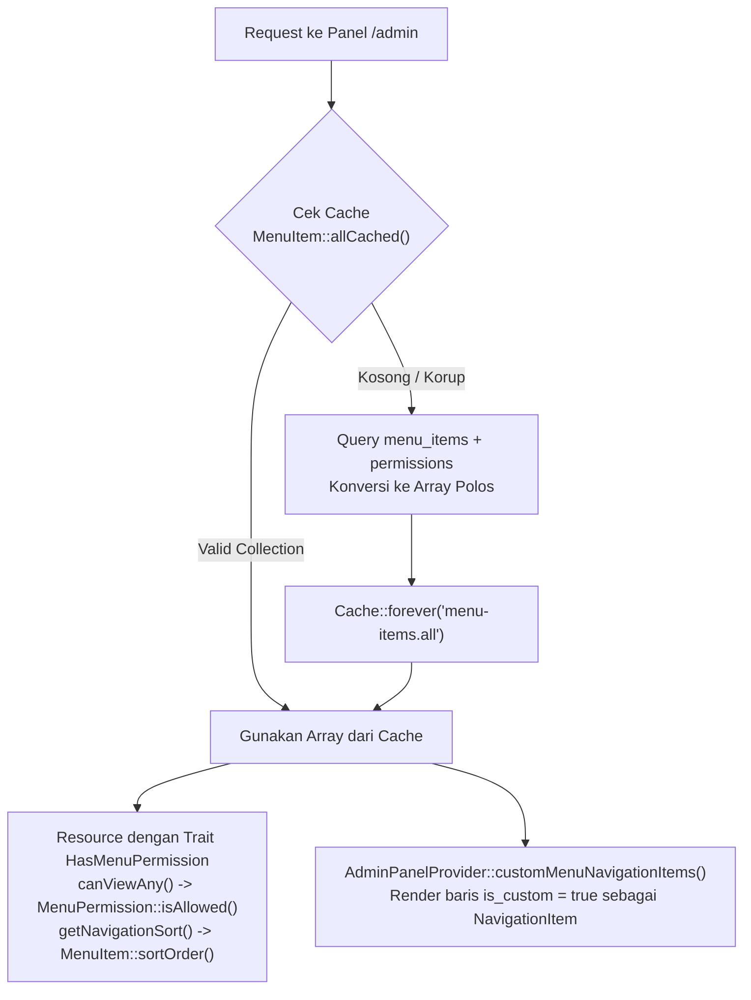

# Dokumentasi Lengkap Aplikasi SATU (Sistem Informasi Kearsipan Terpadu — Versi Bimtek)

> [!IMPORTANT]
> Dokumen ini merupakan hasil analisis menyeluruh terhadap **alur kerja bisnis (business workflow)**, **arsitektur teknis (technical architecture)**, **skema database**, serta **struktur dan logika kode (coding implementation)** dari aplikasi **SATU (Sistem Informasi Kearsipan Terpadu)** yang dikembangkan untuk **Dinas Arsip dan Perpustakaan (ARPUS) Kabupaten Cilacap**.

---

## Daftar Isi

1. [Gambaran Umum & Tech Stack](#1-gambaran-umum--tech-stack)
2. [Struktur Direktori & Pemetaan File](#2-struktur-direktori--pemetaan-file)
3. [Peran Pengguna (RBAC) & Batasan Hak Akses](#3-peran-pengguna-rbac--batasan-hak-akses)
4. [Alur Kerja Aplikasi (End-to-End Business Workflows)](#4-alur-kerja-aplikasi-end-to-end-business-workflows)
5. [Arsitektur Database & Entity-Relationship Diagram (ERD)](#5-arsitektur-database--entity-relationship-diagram-erd)
6. [Alur Teknis Routing, Controller, & Middleware](#6-alur-teknis-routing-controller--middleware)
7. [Bedah Coding & Logika Inti Aplikasi (Codebase Deep-Dive)](#7-bedah-coding--logika-inti-aplikasi-codebase-deep-dive)
8. [Dashboard, Pelaporan, Cetak Fisik, & Utilitas Artisan](#8-dashboard-pelaporan-cetak-fisik--utilitas-artisan)
9. [Keamanan Aplikasi (Security Hardening)](#9-keamanan-aplikasi-security-hardening)

---

## 1. Gambaran Umum & Tech Stack

**SATU (Sistem Informasi Kearsipan Terpadu)** adalah platform digital terpadu untuk pengelolaan **arsip inaktif**, **daftar usul musnah**, **daftar usul permanen (statis)**, **pelacakan penyimpanan fisik (rak & dus ber-QR Code)**, serta **repositori dokumentasi aplikasi** di lingkungan Pemerintah Kabupaten Cilacap.

Versi ini merupakan hasil rancang ulang (*rebuild* & *refactoring* menyeluruh dari SATU V1) yang memperbaiki berbagai kelemahan arsitektur skema lama (seperti ketiadaan *foreign key* pada rak/dus, penentuan hak akses berbasis string nama unit kerja, duplikasi kolom tahap, serta pengurutan kode klasifikasi yang tidak hierarkis).

### Spesifikasi Teknologi (Tech Stack)

| Komponen | Teknologi / Package | Versi | Peran dalam Aplikasi |
| :--- | :--- | :--- | :--- |
| **Bahasa Pemrograman** | PHP | `^8.3` | Runtime utama dengan fitur *Backed Enums* & *PHP Attributes* (`#[Fillable]`, `#[Hidden]`) |
| **Framework Backend** | Laravel Framework | `^13.17` | Routing, ORM Eloquent, Auth, Middleware, Cache, Storage, Console Commands |
| **Admin Panel & UI** | Filament Panel (`filament/filament`) | `^4.0` | Antarmuka CRUD, Tabel Interaktif, Chart Widgets, Form Schema, Export Excel (`Xlsx`) |
| **QR Code Generator** | `chillerlan/php-qrcode` | `^5.0` | Render gambar PNG QR Code secara *on-the-fly* untuk label fisik Dus Arsip |
| **User Impersonation** | `stechstudio/filament-impersonate` | `*` | Memungkinkan Superadmin masuk sebagai pengguna lain untuk keperluan pendampingan/troubleshooting |
| **Frontend Assets** | Vite + Tailwind CSS + Bootstrap Icons | Vite | Bundling aset untuk halaman publik (`welcome`, `lacak-dus`, `repo_dok`) dan panel Filament |

---

## 2. Struktur Direktori & Pemetaan File

Berikut adalah struktur arsitektur kode aplikasi di dalam folder `satu_bimtek`:

```text
satu_bimtek/
├── app/
│   ├── Console/Commands/
│   │   ├── GenerateKodeQrcodeDusArsip.php     # CLI backfill qrcode & kode_qrcode dus lama
│   │   └── SusunNomorSementaraArsip.php       # CLI susun ulang nomor_sementara per periode
│   ├── Enums/
│   │   ├── ArsipKeterangan.php                # Jenis fisik berkas (Asli, Tembusan, Fotocopy, dll.)
│   │   ├── ArsipStatus.php                    # Status arsip (Draft, Input, Terverifikasi)
│   │   ├── NasibAkhir.php                     # Nasib akhir arsip/klasifikasi (Musnah, Permanen)
│   │   ├── PeriodeStatus.php                  # Status periode (Buka, Tutup)
│   │   ├── RepoDokFileType.php                # Tipe item repositori (Berkas Terunggah, Tautan)
│   │   ├── UserRole.php                       # 3 Role: Superadmin, AdminDinas, Pengolah
│   │   └── UserStatus.php                     # Status akun (Verify, Active, Banned)
│   ├── Filament/
│   │   ├── Concerns/
│   │   │   ├── HasMenuPermission.php          # Trait gate akses & urutan menu dinamis per Resource
│   │   │   └── RedirectsToIndex.php           # Trait redirect ke halaman list setelah Create/Edit
│   │   ├── Exports/
│   │   │   └── ArsipExporter.php              # Konfigurasi 24 kolom ekspor Excel (.xlsx) data arsip
│   │   ├── Pages/
│   │   │   ├── Auth/EditProfile.php           # Halaman profil user untuk ubah Alias User
│   │   │   ├── Auth/Login.php                 # Login panel Filament (Email/NIP + reCAPTCHA v2)
│   │   │   └── ManajemenMenu.php              # Halaman matriks menu versi lama (dipensiunkan)
│   │   ├── Resources/
│   │   │   ├── DusArsipResource.php           # CRUD Dus Arsip + QR Code + Cetak Label
│   │   │   ├── InaktifResource.php            # CRUD Arsip Inaktif + Manufer + Penempatan Rak/Dus
│   │   │   ├── MasterKodeResource.php         # Tabel Read-Only 2.952 Kode Klasifikasi & JRA
│   │   │   ├── MenuItemResource.php           # Manajemen Menu Sidebar (Drag-order, Toggle Role, Custom Link)
│   │   │   ├── OpdIndukResource.php           # CRUD Dinas / Instansi Induk (Superadmin)
│   │   │   ├── OpdResource.php                # CRUD Bidang / Unit Kerja (Superadmin)
│   │   │   ├── PeriodeResource.php            # CRUD Periode Tahap Arsip + Buka Kembali Kunci Manufer
│   │   │   ├── RakArsipResource.php           # CRUD Rak Penyimpanan Arsip
│   │   │   ├── RepoDokFolderResource.php      # CRUD Folder & Berkas Repositori Dokumentasi
│   │   │   ├── UserResource.php               # CRUD Pengguna + Impersonate (Superadmin)
│   │   │   ├── UsulMusnahResource.php         # Daftar Read-Only + Export Arsip Usul Musnah
│   │   │   └── UsulPermanenResource.php       # Daftar Read-Only + Export Arsip Usul Permanen
│   │   └── Widgets/
│   │       ├── ArsipStatsOverview.php         # 4 Kartu Statistik Utama Dashboard
│   │       ├── InstansiOverviewTable.php      # Tabel Ringkasan Arsip per Instansi + Modal Unit Kerja
│   │       ├── ArsipPerBidangChart.php        # Bar Chart Horizontal Arsip per Bidang
│   │       ├── ArsipTrenBulananChart.php      # Line Chart Tren Arsip Masuk Bulanan per Tahun
│   │       ├── ArsipNasibAkhirChart.php       # Doughnut Chart Musnah vs Permanen
│   │       └── ArsipPerStatusChart.phpxx      # Bar Chart Arsip per Status (nonaktif/.phpxx)
│   ├── Http/
│   │   ├── Controllers/
│   │   │   ├── UserController.php             # Handler POST /login dari Landing Page Publik
│   │   │   ├── ArsipKartuController.php       # Cetak Kartu Deskripsi Arsip (A4 Posisi Kustom)
│   │   │   ├── DusArsipLabelController.php    # Cetak Label Boks/Dus Arsip (Tunggal & Massal)
│   │   │   ├── DusArsipLacakController.php    # Pencarian Publik Lacak Dus tanpa Login
│   │   │   ├── DusArsipRangkumanController.php# Halaman Publik Rangkuman Isi Dus + Render PNG QR
│   │   │   └── RepoDokController.php          # Browser & Pencarian Repositori Dokumentasi (/repo_dok)
│   │   └── Middleware/
│   │       └── SecurityHeaders.php            # Injeksi HTTP Security Headers pada seluruh response
│   ├── Models/                                # 13 Model Eloquent (Arsip, DusArsip, MasterKode, dll.)
│   ├── Policies/                              # 8 Policy Otorisasi Model
│   ├── Providers/
│   │   ├── AppServiceProvider.php             # Registrasi Render Hook link Lacak Dus di form login
│   │   └── Filament/AdminPanelProvider.php    # Konfigurasi Panel /admin, Font, Warna, & Custom Menu
│   └── Support/
│       └── Recaptcha.php                      # Detektor terpusat environment localhost untuk bypass Captcha
├── database/
│   ├── migrations/                            # 23 file migrasi skema database
│   └── seeders/                               # DatabaseSeeder, UserSeeder, MasterKodeSeeder, dll.
├── resources/views/                           # Blade templates (welcome, kartu, label, lacak, rangkuman, repo-dok)
└── routes/web.php                             # Definisi rute publik dan rute terautentikasi
```

---

## 3. Peran Pengguna (RBAC) & Batasan Hak Akses

Aplikasi menerapkan sistem **Role-Based Access Control (RBAC)** 3 tingkat yang didefinisikan pada [`App\Enums\UserRole`](file:///c:/Users/sevan/Documents/Diskominfo%20Kerja%20Teknis/satu_bimtek/app/Enums/UserRole.php) dan diikat ke struktur organisasi 2 jenjang: **Dinas / Instansi Induk** ([`OpdInduk`](file:///c:/Users/sevan/Documents/Diskominfo%20Kerja%20Teknis/satu_bimtek/app/Models/OpdInduk.php)) dan **Bidang / Unit Kerja** ([`Opd`](file:///c:/Users/sevan/Documents/Diskominfo%20Kerja%20Teknis/satu_bimtek/app/Models/Opd.php)).



### Matriks Hak Akses per Modul & Fitur

| Modul / Fitur | `Superadmin` | `Admin Dinas` (`admin_dinas`) | `Pengolah` (`pengolah`) |
| :--- | :--- | :--- | :--- |
| **Cakupan Data (*Data Scope*)** | Seluruh Dinas & Bidang | Seluruh Bidang dalam **1 Dinas** (`opd_induk_id`) | Hanya **1 Bidang** miliknya (`opd_id`) |
| **Dinas (`OpdIndukResource`)** | CRUD Penuh (Cegah hapus jika ada Bidang/User) | Tidak punya akses (403) | Tidak punya akses (403) |
| **Bidang (`OpdResource`)** | CRUD Penuh (Cegah hapus jika ada relasi) | Tidak punya akses (403) | Tidak punya akses (403) |
| **Pengguna (`UserResource`)** | CRUD Penuh + Impersonate non-superadmin | Tidak punya akses (403) | Tidak punya akses (403) |
| **Kode Klasifikasi (`MasterKodeResource`)** | Read-Only + Filter | Tidak punya akses (403) | Tidak punya akses (403) |
| **Manajemen Menu (`MenuItemResource`)** | Kelola urutan, izin role, & tambah link kustom | Tidak punya akses (403) | Tidak punya akses (403) |
| **Kelola Repo Dokumentasi (`RepoDokFolderResource`)** | CRUD Folder, Sub-folder, Berkas, & Tautan | Tidak punya akses (403) | Tidak punya akses (403) |
| **Baca Repo Dokumentasi (`/repo_dok`)** | Buka & Unduh | Buka & Unduh | Buka & Unduh |
| **Periode (`PeriodeResource`)** | Lihat, Edit, Hapus, & **Buka Kembali** kunci Manufer (**Tidak bisa Create**) | Lihat, **Create**, Edit, Hapus (se-Dinas, selama belum Manufer) | Lihat, **Create**, Edit, Hapus (se-Bidang, selama belum Manufer) |
| **Rak Arsip (`RakArsipResource`)** | Lihat, Edit, Hapus (**Tidak bisa Create**) | Lihat, **Create**, Edit, Hapus (se-Dinas) | Lihat, **Create**, Edit, Hapus (se-Bidang) |
| **Dus Arsip (`DusArsipResource`)** | Lihat, Edit, Hapus, Cetak Label, Generate QR (**Tidak bisa Create**) | Lihat, **Create**, Edit, Hapus, Cetak Label, Generate QR (se-Dinas) | Lihat, **Create**, Edit, Hapus, Cetak Label, Generate QR (se-Bidang) |
| **Arsip Inaktif (`InaktifResource`)** | Lihat, Edit (ubah status ke `Terverifikasi`), Hapus, Cetak Kartu, Export Excel (**Tidak bisa Create / Manufer / Tempatkan Fisik**) | Lihat, **Create** (status otomatis `Draft`), Edit, Hapus, **Manufer**, **Tempatkan ke Rak/Dus**, Cetak Kartu, Export Excel | Lihat, **Create** (status otomatis `Draft`), Edit, Hapus, **Manufer**, **Tempatkan ke Rak/Dus**, Cetak Kartu, Export Excel |
| **Usul Musnah & Permanen** | Read-Only + Filter + Export Excel | Read-Only + Filter + Export Excel (se-Dinas) | Read-Only + Filter + Export Excel (se-Bidang) |

> [!NOTE]
> **Prinsip Desain Penting:** Data operasional kearsipan (`Periode`, `RakArsip`, `DusArsip`, dan `Arsip`) secara bisnis adalah milik **Dinas** dan **Bidang**, bukan milik Superadmin. Oleh karena itu, seluruh Policy terkait (`PeriodePolicy`, `RakArsipPolicy`, `DusArsipPolicy`, `ArsipPolicy`) sengaja mengembalikan `false` pada method `create()` untuk `Superadmin`.

---

## 4. Alur Kerja Aplikasi (End-to-End Business Workflows)

Siklus hidup pengelolaan arsip pada aplikasi SATU berjalan secara berurutan dari persiapan organisasi hingga pelacakan fisik dan penyusutan arsip (Musnah/Permanen).



### Tahap 1: Setup Master Organisasi & Akun Pengguna (Superadmin)
1. **Input Dinas (`OpdIndukResource`)**: Superadmin mendaftarkan Dinas/Instansi (`kode_instansi`, `instansi`, `singkatan_instansi`).
2. **Input Bidang (`OpdResource`)**: Superadmin membuat Bidang/Unit Kerja dengan memilih Dinas induknya (`opd_induk_id`). Saat Dinas dipilih, kolom `kode_instansi` dan `instansi` pada tabel `opds` otomatis disalin dari Dinas induknya dan dikunci agar tidak pernah berbeda.
3. **Input Pengguna (`UserResource`)**: Superadmin membuat akun pegawai dengan menetapkan `role` (`superadmin`, `admin_dinas`, atau `pengolah`), `status` (`active`, `verify`, `banned`), serta mengaitkannya ke `opd_induk_id` dan `opd_id`.
4. **Pengaturan Alias User (`EditProfile`)**: Setiap pengguna yang login dapat membuka menu **Profil** di pojok kanan atas untuk mengatur `alias_user` unik (contoh: `UMI`). Alias ini menjadi awalan **Nomor Sementara** setiap arsip yang mereka input.

### Tahap 2: Persiapan Penyimpanan Fisik — Rak & Dus Arsip (Admin Dinas / Pengolah)
1. **Pembuatan Rak Arsip (`RakArsipResource`)**:
   - Pengguna membuat `nomor_rak`.
   - Untuk `Pengolah`, `opd_id` dan `opd_induk_id` otomatis dipaksa dari akun yang login. Untuk `Admin Dinas`, ia memilih Bidang di bawah Dinasnya, lalu `opd_induk_id` diturunkan otomatis dari Bidang tersebut.
2. **Pembuatan Dus Arsip (`DusArsipResource`)**:
   - Pengguna **wajib** memilih Rak Arsip (`rak_arsip_id`) terlebih dahulu. Jika belum ada Rak Arsip pada Bidang/Dinasnya, Dus Arsip tidak bisa dibuat.
   - `opd_id` dan `opd_induk_id` Dus Arsip tidak diinput manual, melainkan **selalu diwarisi dari Rak Arsip** yang dipilih ([`CreateDusArsip::mutateFormDataBeforeCreate()`](file:///c:/Users/sevan/Documents/Diskominfo%20Kerja%20Teknis/satu_bimtek/app/Filament/Resources/DusArsipResource/Pages/CreateDusArsip.php#L22-L30)).
   - Begitu Dus Arsip tersimpan, hook [`CreateDusArsip::afterCreate()`](file:///c:/Users/sevan/Documents/Diskominfo%20Kerja%20Teknis/satu_bimtek/app/Filament/Resources/DusArsipResource/Pages/CreateDusArsip.php#L42-L51) otomatis mengisi:
     - `qrcode`: URL lengkap menuju halaman rangkuman dus (`/dus/{id}/rangkuman`).
     - `kode_qrcode`: Kode pendek unik berformat `{opd_induk_id}-{rak_arsip_id}-{Ymd}` (contoh: `3-12-20260915`, ditambah suffix `-2`, `-3` jika dibuat di hari dan rak yang sama). Kode ini bersifat **permanen (immutable)** setelah dibuat pertama kali.

### Tahap 3: Pembukaan Periode / Tahap Input (Admin Dinas / Pengolah)
1. Sebelum menginput arsip, Bidang harus memiliki minimal satu **Periode** ([`PeriodeResource`](file:///c:/Users/sevan/Documents/Diskominfo%20Kerja%20Teknis/satu_bimtek/app/Filament/Resources/PeriodeResource.php)) yang berstatus `Buka` dan belum dimanufer (`manufer_at = null`).
2. Saat menambah Periode baru, kolom `tahap` dihitung otomatis di form dan divalidasi ulang di server ([`CreatePeriode::mutateFormDataBeforeCreate()`](file:///c:/Users/sevan/Documents/Diskominfo%20Kerja%20Teknis/satu_bimtek/app/Filament/Resources/PeriodeResource/Pages/CreatePeriode.php#L22-L48)) menggunakan rumus:
   $$\text{Tahap Baru} = \max(\text{tahap pada Bidang \& Tahun tersebut}) + 1$$
   dengan batas maksimal `MAKS_TAHAP = 10`.

### Tahap 4: Pencatatan Arsip Inaktif & Perhitungan Otomatis (Admin Dinas / Pengolah)
Saat pengguna menginput arsip di menu **Arsip** ([`InaktifResource`](file:///c:/Users/sevan/Documents/Diskominfo%20Kerja%20Teknis/satu_bimtek/app/Filament/Resources/InaktifResource.php)):
1. **Penentuan Periode Otomatis**: Field `periode_id` dikunci dan otomatis diisi dengan **periode terbuka terkecil** (tahun paling awal, lalu tahap terkecil yang berstatus `Buka` dan `manufer_at IS NULL`) milik Bidang arsip tersebut melalui [`InaktifResource::periodeTerbukaTerkecil()`](file:///c:/Users/sevan/Documents/Diskominfo%20Kerja%20Teknis/satu_bimtek/app/Filament/Resources/InaktifResource.php#L316-L329). Jika Bidang belum punya periode terbuka, proses simpan dihentikan (`Halt`) dengan notifikasi peringatan.
2. **Penurunan Retensi & Nasib Akhir dari Kode Klasifikasi**: Saat pengguna memilih `master_kode_id`, callback `afterStateUpdated` mengambil data [`MasterKode`](file:///c:/Users/sevan/Documents/Diskominfo%20Kerja%20Teknis/satu_bimtek/app/Models/MasterKode.php) lalu mengisi otomatis:
   - `aktif` ( masa retensi aktif dalam tahun)
   - `inaktif` (masa retensi inaktif dalam tahun)
   - `nasib_akhir` (`musnah` atau `permanen`, diambil dari `master_kodes.keterangan` dan dikunci di form).
3. **Perhitungan Otomatis `tanggal_musnah`**: Setiap kali `tanggal`, `aktif`, atau `inaktif` berubah, [`InaktifResource::recalculateTanggalMusnah()`](file:///c:/Users/sevan/Documents/Diskominfo%20Kerja%20Teknis/satu_bimtek/app/Filament/Resources/InaktifResource.php#L656-L675) menghitung tanggal berakhirnya retensi sesuai kaidah kearsipan (dihitung mulai **1 Januari tahun berikutnya** setelah tanggal arsip):
   $$\text{Tanggal Musnah} = \text{1 Januari } (\text{Tahun Tanggal Arsip} + 1) + (\text{Retensi Aktif} + \text{Retensi Inaktif})\text{ Tahun}$$
4. **Penomoran Sementara Otomatis (`nomor_sementara`)**: Saat record `Arsip` dibuat (`creating`) atau pindah periode (`updating`), model event pada [`Arsip::booted()`](file:///c:/Users/sevan/Documents/Diskominfo%20Kerja%20Teknis/satu_bimtek/app/Models/Arsip.php#L37-L49) memanggil [`isiNomorSementara()`](file:///c:/Users/sevan/Documents/Diskominfo%20Kerja%20Teknis/satu_bimtek/app/Models/Arsip.php#L56-L72):
   - Mencari `max(urut_sementara) + 1` di dalam `periode_id` yang sama.
   - Membentuk `nomor_sementara` dengan format `{alias_user_atau_id}-{urut}` (misal: `UMI-1`, `UMI-2`).
5. **Status Awal Arsip**: Untuk `Admin Dinas` dan `Pengolah`, kolom `status` dikunci dan dipaksa bernilai `Draft` (`ArsipStatus::Draft`).

### Tahap 5: Proses Manufer & Penguncian Tahap (Admin Dinas / Pengolah)



- **Apa itu Manufer?** Manufer adalah proses penyusunan urutan definitif berkas arsip dalam satu tahap (`Periode`).
- Logika di [`ListInaktif::runManufer()`](file:///c:/Users/sevan/Documents/Diskominfo%20Kerja%20Teknis/satu_bimtek/app/Filament/Resources/InaktifResource/Pages/ListInaktif.php#L307-L378) mengurutkan seluruh arsip dalam periode tersebut berdasarkan:
  1. `master_kodes.sort_key` (urutan kode klasifikasi berjenjang yang sudah di-*zero-pad* 4 digit per segmen)
  2. `arsips.tahun`
  3. `MONTH(arsips.tanggal)`
  4. `arsips.tanggal`
  5. `arsips.id`
- Seluruh arsip dalam tahap tersebut diberi **Nomor Definitif** (`nomor = 1, 2, 3, ...`), statusnya dinaikkan otomatis dari `Draft` menjadi `Input` (`ArsipStatus::Input`), dan periode langsung **dikunci** (`manufer_at` & `manufer_by` terisi).
- Selama periode terkunci (`Periode::isManufer() === true`):
  - Tidak ada arsip baru yang bisa masuk ke periode tersebut.
  - Tidak ada arsip di periode tersebut yang bisa diedit atau dihapus (`ArsipPolicy::update()` & `delete()` mengembalikan `false` untuk **semua role termasuk Superadmin**).
  - Periode tersebut tidak bisa diedit atau dihapus (`PeriodePolicy::update()` & `delete()`).
  - Hanya **Superadmin** yang dapat membuka kunci tersebut melalui tombol **Buka Kembali** (`bukaKembali`) di [`PeriodeResource`](file:///c:/Users/sevan/Documents/Diskominfo%20Kerja%20Teknis/satu_bimtek/app/Filament/Resources/PeriodeResource.php#L191-L209).

### Tahap 6: Penempatan Fisik ke Rak & Dus Arsip (Pasca-Manufer)
Sesuai alur kerja fisik kearsipan, berkas baru dimasukkan ke dalam Dus dan Rak **setelah** memiliki Nomor Definitif hasil Manufer:
1. **Penempatan Per Baris (`tempatkanFisik`)**: Tombol **Tempatkan ke Rak/Dus** pada baris tabel [`InaktifResource`](file:///c:/Users/sevan/Documents/Diskominfo%20Kerja%20Teknis/satu_bimtek/app/Filament/Resources/InaktifResource.php#L583-L624) hanya muncul jika periode arsip sudah dimanufer (`$record->periode?->isManufer()`) dan diakses oleh `Admin Dinas` atau `Pengolah`. Aksi ini hanya mengubah kolom `rak_arsip_id` dan `dus_arsip_id` tanpa melanggar kunci `ArsipPolicy::update()`.
2. **Penempatan Massal Secara Interval (`tempatkanInterval`)**: Melalui tombol **Tempatkan ke Rak/Dus (Interval)** di header [`ListInaktif`](file:///c:/Users/sevan/Documents/Diskominfo%20Kerja%20Teknis/satu_bimtek/app/Filament/Resources/InaktifResource/Pages/ListInaktif.php#L72-L146), pengguna memilih Tahap yang sudah dimanufer, memasukkan rentang Nomor Definitif (`nomor_dari` s.d. `nomor_sampai`), memilih Rak & Dus tujuan, serta opsi toggle `timpa`. Sistem menampilkan pratinjau jumlah arsip secara *real-time* dan mengeksekusi penempatan dalam 1 query transaksi DB.

### Tahap 7: Pelacakan QR Dus, Verifikasi, & Penyusutan (Usul Musnah / Permanen)
1. **Cetak Label Dus & Pelacakan QR Code Publik**:
   - Admin Dinas/Pengolah mencetak label dus dari [`DusArsipResource`](file:///c:/Users/sevan/Documents/Diskominfo%20Kerja%20Teknis/satu_bimtek/app/Filament/Resources/DusArsipResource.php#L234-L239) lalu menempelkannya di boks fisik.
   - Staf di gudang arsip (tanpa perlu akun login) memindai QR Code pada dus fisik menggunakan ponsel. QR Code menghasilkan teks `kode_qrcode` (misal `3-12-20260915`), yang kemudian dimasukkan ke halaman publik `/lacak-dus` untuk melihat daftar lengkap isi berkas di dalam dus tersebut.
2. **Verifikasi oleh Superadmin**:
   - Superadmin memeriksa data arsip dan dapat mengubah kolom `status` arsip menjadi **Terverifikasi** (`ArsipStatus::Verify`).
3. **Daftar Usul Musnah & Daftar Usul Permanen**:
   - Arsip dengan `nasib_akhir = 'musnah'` otomatis tampil di menu **Arsip M/P > Daftar Usul Musnah** ([`UsulMusnahResource`](file:///c:/Users/sevan/Documents/Diskominfo%20Kerja%20Teknis/satu_bimtek/app/Filament/Resources/UsulMusnahResource.php)). Jika `tanggal_musnah` sudah lewat dari tanggal hari ini (`Arsip::isExpired()`), tanggal musnah dicetak tebal berwarna merah (`danger`).
   - Arsip dengan `nasib_akhir = 'permanen'` otomatis tampil di menu **Arsip M/P > Daftar Usul Permanen** ([`UsulPermanenResource`](file:///c:/Users/sevan/Documents/Diskominfo%20Kerja%20Teknis/satu_bimtek/app/Filament/Resources/UsulPermanenResource.php)).
   - Kedua daftar ini dapat difilter per rentang tahun (`dari` - `sampai`) dan diekspor ke file Excel (`.xlsx`).

---

## 5. Arsitektur Database & Entity-Relationship Diagram (ERD)

Berikut adalah diagram relasi entitas (ERD) dari seluruh tabel utama aplikasi SATU:



### Catatan Penting Desain Skema & Integritas Referensial
1. **Urutan Migrasi & Foreign Key Rak/Dus**: Pada SATU V1, tabel `rak_arsips` dan `dus_arsips` dibuat setelah `arsips` sehingga `rak_arsip_id` dan `dus_arsip_id` hanya menjadi index biasa tanpa *foreign key*. Pada aplikasi ini, urutan migrasi diperbaiki (`000006_create_rak_arsips_table` -> `000007_create_dus_arsips_table` -> `000008_create_arsips_table`) sehingga seluruh relasi terjaga dengan *foreign key constraint* penuh.
2. **Proteksi Penghapusan Data Induk (*Orphan Prevention*)**:
   - Relasi `dus_arsips.rak_arsip_id` ke `rak_arsips` menggunakan `RESTRICT` di level database ditambah penonaktifan tombol hapus di [`RakArsipResource`](file:///c:/Users/sevan/Documents/Diskominfo%20Kerja%20Teknis/satu_bimtek/app/Filament/Resources/RakArsipResource.php#L120-L128) selama rak masih memiliki dus.
   - Meskipun FK `opd_induk_id` dan `opd_id` menggunakan `nullOnDelete()` di level DB, tombol `DeleteAction` di [`OpdIndukResource`](file:///c:/Users/sevan/Documents/Diskominfo%20Kerja%20Teknis/satu_bimtek/app/Filament/Resources/OpdIndukResource.php#L101-L113) dan [`OpdResource`](file:///c:/Users/sevan/Documents/Diskominfo%20Kerja%20Teknis/satu_bimtek/app/Filament/Resources/OpdResource.php#L147-L165) sengaja dikunci (`disabled`) apabila Dinas/Bidang tersebut masih memiliki Bidang, User, Periode, Rak, Dus, atau Arsip. Hal ini mencegah munculnya data "yatim" (`opd_id = null`) yang akan merusak *scoping* hak akses per Dinas/Bidang.
3. **Perbedaan Kolom `keterangan` pada `master_kodes` vs `arsips`**:
   - `master_kodes.keterangan` menyimpan **Nasib Akhir** klasifikasi (`musnah` / `permanen`), di-*cast* ke [`App\Enums\NasibAkhir`](file:///c:/Users/sevan/Documents/Diskominfo%20Kerja%20Teknis/satu_bimtek/app/Enums/NasibAkhir.php).
   - `arsips.keterangan` menyimpan **Jenis Berkas Fisik** (`asli`, `tembusan`, `fotocopy`, `asli_tembusan`, `fotocopy_tembusan`), di-*cast* ke [`App\Enums\ArsipKeterangan`](file:///c:/Users/sevan/Documents/Diskominfo%20Kerja%20Teknis/satu_bimtek/app/Enums/ArsipKeterangan.php) untuk dilingkari pada Kartu Deskripsi Arsip.

---

## 6. Alur Teknis Routing, Controller, & Middleware

Seluruh rute web didefinisikan di [`routes/web.php`](file:///c:/Users/sevan/Documents/Diskominfo%20Kerja%20Teknis/satu_bimtek/routes/web.php) dan dikombinasikan dengan rute panel Filament (`/admin/*`) yang dikonfigurasi di [`AdminPanelProvider`](file:///c:/Users/sevan/Documents/Diskominfo%20Kerja%20Teknis/satu_bimtek/app/Providers/Filament/AdminPanelProvider.php).

### Daftar Rute Aplikasi (`routes/web.php`)

| Method & URI | Route Name | Controller / Handler | Middleware | Keterangan Teknis |
| :--- | :--- | :--- | :--- | :--- |
| `GET /` | `welcome` | Closure | `web` | Jika sudah login (`auth()->check()`), redirect ke `/admin` (penting juga untuk redirect balik `filament-impersonate`). Jika belum, tampilkan landing page `welcome.blade.php`. |
| `GET /login` | `login` | Closure | `web` | Sama dengan `GET /` (menampilkan `welcome.blade.php` atau redirect ke `/admin`). |
| `POST /login` | `login.post` | [`UserController@login`](file:///c:/Users/sevan/Documents/Diskominfo%20Kerja%20Teknis/satu_bimtek/app/Http/Controllers/UserController.php#L24-L67) | `web`, `throttle:6,1` | Memproses login dari halaman depan menggunakan Email/NIP + reCAPTCHA + cek `UserStatus::Active`. |
| `GET /lacak-dus` | `dus-arsip.lacak` | [`DusArsipLacakController@index`](file:///c:/Users/sevan/Documents/Diskominfo%20Kerja%20Teknis/satu_bimtek/app/Http/Controllers/DusArsipLacakController.php#L27-L30) | `web` (Publik) | Form publik tanpa login untuk melacak isi dus dari Kode QR, ID Dus, atau URL. |
| `POST /lacak-dus` | `dus-arsip.lacak.cari` | [`DusArsipLacakController@cari`](file:///c:/Users/sevan/Documents/Diskominfo%20Kerja%20Teknis/satu_bimtek/app/Http/Controllers/DusArsipLacakController.php#L32-L48) | `web`, `throttle:15,1` | Me-resolve input menjadi `dusArsipId` lalu redirect ke `dus-arsip.rangkuman`. |
| `GET /dus/{dusArsip}/rangkuman` | `dus-arsip.rangkuman` | [`DusArsipRangkumanController@show`](file:///c:/Users/sevan/Documents/Diskominfo%20Kerja%20Teknis/satu_bimtek/app/Http/Controllers/DusArsipRangkumanController.php#L36-L49) | `web`, `throttle:30,1` | Halaman publik daftar arsip di dalam suatu dus beserta gambar & teks QR Code. |
| `GET /dus/{dusArsip}/qrcode` | `dus-arsip.qrcode` | [`DusArsipRangkumanController@qrcode`](file:///c:/Users/sevan/Documents/Diskominfo%20Kerja%20Teknis/satu_bimtek/app/Http/Controllers/DusArsipRangkumanController.php#L58-L78) | `web`, `throttle:30,1` | Menghasilkan image `image/png` QR Code dari `kode_qrcode` dus. |
| `GET /arsip/{arsip}/kartu` | `arsip.kartu` | [`ArsipKartuController@show`](file:///c:/Users/sevan/Documents/Diskominfo%20Kerja%20Teknis/satu_bimtek/app/Http/Controllers/ArsipKartuController.php#L20-L30) | `web`, `auth` | Halaman cetak Kartu Deskripsi Arsip (dilindungi `auth` + `ArsipPolicy::view`). |
| `GET /dus/label/cetak` | `dus-arsip.label` | [`DusArsipLabelController@cetak`](file:///c:/Users/sevan/Documents/Diskominfo%20Kerja%20Teknis/satu_bimtek/app/Http/Controllers/DusArsipLabelController.php#L30-L52) | `web`, `auth` | Halaman cetak Label Dus Arsip (`?ids=1,2,3`), mempertahankan urutan ID sesuai pilihan tabel. |
| `GET /repo_dok` | `repo-dok.index` | [`RepoDokController@index`](file:///c:/Users/sevan/Documents/Diskominfo%20Kerja%20Teknis/satu_bimtek/app/Http/Controllers/RepoDokController.php#L25-L28) | `web`, `auth` | Halaman utama Repositori Dokumentasi untuk seluruh pengguna terautentikasi. |
| `GET /repo_dok/cari` | `repo-dok.cari` | [`RepoDokController@cari`](file:///c:/Users/sevan/Documents/Diskominfo%20Kerja%20Teknis/satu_bimtek/app/Http/Controllers/RepoDokController.php#L69-L110) | `web`, `auth` | Pencarian nama/deskripsi folder dan berkas/tautan di Repositori Dokumentasi. |
| `GET /repo_dok/folder/{folder}` | `repo-dok.folder` | [`RepoDokController@folder`](file:///c:/Users/sevan/Documents/Diskominfo%20Kerja%20Teknis/satu_bimtek/app/Http/Controllers/RepoDokController.php#L30-L33) | `web`, `auth` | Menampilkan isi sub-folder dan daftar berkas/tautan pada suatu folder. |
| `GET /repo_dok/berkas/{file}/unduh`| `repo-dok.unduh` | [`RepoDokController@unduh`](file:///c:/Users/sevan/Documents/Diskominfo%20Kerja%20Teknis/satu_bimtek/app/Http/Controllers/RepoDokController.php#L112-L118) | `web`, `auth` | Mengunduh berkas fisik dari disk `public` dengan nama asli dokumen. |

---

## 7. Bedah Coding & Logika Inti Aplikasi (Codebase Deep-Dive)

Bagian ini mengulas cara kerja teknis dari fitur-fitur utama di dalam kode sumber.

### 7.1. Alur Autentikasi Ganda (Email/NIP) & Smart reCAPTCHA
Aplikasi menyediakan **dua pintu login** yang sama-sama menuju panel `/admin`:
1. **Landing Page Publik (`/` atau `/login`)**: Ditangani oleh [`UserController::login()`](file:///c:/Users/sevan/Documents/Diskominfo%20Kerja%20Teknis/satu_bimtek/app/Http/Controllers/UserController.php#L24-L67).
2. **Halaman Login Panel Filament (`/admin/login`)**: Ditangani oleh [`App\Filament\Pages\Auth\Login`](file:///c:/Users/sevan/Documents/Diskominfo%20Kerja%20Teknis/satu_bimtek/app/Filament/Pages/Auth/Login.php).

**Mekanisme Deteksi Email vs NIP:**
- Input form menggunakan field tunggal bernama `login` (bukan `email` agar tidak ditolak validasi format email saat pegawai memasukkan 18 digit NIP).
- Jika nilai input mengandung karakter `@` / lolos `FILTER_VALIDATE_EMAIL`, kredensial dicocokkan ke kolom `email`; jika tidak, dicocokkan ke kolom `nip`.
- Setelah `Auth::attempt()` berhasil, sistem memeriksa apakah `$user->status === UserStatus::Active` (juga diterapkan di [`User::canAccessPanel()`](file:///c:/Users/sevan/Documents/Diskominfo%20Kerja%20Teknis/satu_bimtek/app/Models/User.php#L63-L66)). Jika status user masih `Verify` atau `Banned`, sesi langsung di-logout dan pengguna diberi pesan spesifik.

**Arsitektur Smart reCAPTCHA (`App\Support\Recaptcha`):**
- Di jaringan kantor/pemda atau saat pengembangan di localhost, layanan Google reCAPTCHA sering terblokir atau domain lokal belum di-*whitelist*.
- Kelas [`App\Support\Recaptcha::isLocalHost()`](file:///c:/Users/sevan/Documents/Diskominfo%20Kerja%20Teknis/satu_bimtek/app/Support/Recaptcha.php#L45-L60) menjadi *single source of truth* yang mengecek apakah `request()->getHost()` adalah `localhost`, `127.0.0.1`, `::1`, atau berakhiran `.test` / `.localhost`.
- Jika diakses dari localhost, widget reCAPTCHA **disembunyikan di Blade** dan verifikasi server **dilewati secara otomatis** tanpa perlu mengubah kode. Begitu di-*deploy* ke domain publik dan `NOCAPTCHA_SITEKEY` / `RECAPTCHA_SITE_KEY` diisi di `.env`, proteksi captcha langsung aktif.
- Endpoint verifikasi menggunakan `https://www.recaptcha.net/recaptcha/api/siteverify` (domain alternatif resmi Google agar tidak terkena blokir DNS `google.com`) dengan timeout 5 detik dan mekanisme **fail-open** pada `ConnectionException` supaya pengguna tidak terkunci total apabila server gagal menghubungi Google.

### 7.2. Sistem Manajemen Menu Dinamis & Self-Healing Cache
Visibilitas dan urutan menu di sidebar Filament tidak di-*hardcode* di Policy, melainkan dikelola secara dinamis melalui [`MenuItem`](file:///c:/Users/sevan/Documents/Diskominfo%20Kerja%20Teknis/satu_bimtek/app/Models/MenuItem.php), [`MenuPermission`](file:///c:/Users/sevan/Documents/Diskominfo%20Kerja%20Teknis/satu_bimtek/app/Models/MenuPermission.php), dan trait [`HasMenuPermission`](file:///c:/Users/sevan/Documents/Diskominfo%20Kerja%20Teknis/satu_bimtek/app/Filament/Concerns/HasMenuPermission.php).



- **Dua Jenis Baris Menu (`menu_items`)**:
  1. **Modul Kode (`is_custom = false`)**: Mewakili Filament Resource asli (`rak_arsip`, `dus_arsip`, `arsip`, `usul_musnah`, `usul_permanen`, `periode`, `master_kode`, `opd_induk`, `opd`, `user`). Setiap Resource memasang trait [`HasMenuPermission`](file:///c:/Users/sevan/Documents/Diskominfo%20Kerja%20Teknis/satu_bimtek/app/Filament/Concerns/HasMenuPermission.php) yang meng-*override* `canViewAny()` (sekaligus memblokir akses URL langsung jika tidak diizinkan) dan `getNavigationSort()`. Baris modul kode **tidak boleh dihapus** dari UI karena `MenuPermission::isAllowed()` memiliki fallback `true` jika `module_key` tidak ditemukan.
  2. **Menu Link Kustom (`is_custom = true`)**: Dibuat oleh Superadmin lewat tombol **Tambah Menu (Link)** di [`MenuItemResource`](file:///c:/Users/sevan/Documents/Diskominfo%20Kerja%20Teknis/satu_bimtek/app/Filament/Resources/MenuItemResource.php) (misal tautan ke `/repo_dok`, `/lacak-dus`, atau URL eksternal). Didaftarkan secara dinamis ke sidebar melalui [`AdminPanelProvider::customMenuNavigationItems()`](file:///c:/Users/sevan/Documents/Diskominfo%20Kerja%20Teknis/satu_bimtek/app/Providers/Filament/AdminPanelProvider.php#L106-L117).
- **Self-Healing Plain-Array Cache**:
  - Method [`MenuItem::allCached()`](file:///c:/Users/sevan/Documents/Diskominfo%20Kerja%20Teknis/satu_bimtek/app/Models/MenuItem.php#L84-L125) menyimpan struktur menu dan matriks izin sebagai `Collection` berisi **array PHP polos** (bukan objek Model Eloquent atau Enum) untuk mencegah error unserialize `__PHP_Incomplete_Class` saat *deploy* atau `composer dump-autoload`.
  - Cache otomatis di-*flush* setiap kali model `MenuItem` atau `MenuPermission` disimpan/dihapus (`booted()`), serta saat urutan tabel di-*drag-and-drop* ([`ListMenuItems::reorderTable()`](file:///c:/Users/sevan/Documents/Diskominfo%20Kerja%20Teknis/satu_bimtek/app/Filament/Resources/MenuItemResource/Pages/ListMenuItems.php#L34-L38)).

### 7.3. Tiga Lapisan Pengamanan Data (*Defense in Depth*)
Untuk memastikan pengguna tidak pernah melihat atau memanipulasi data milik Dinas/Bidang lain, aplikasi menerapkan 3 lapisan pemeriksaan:
1. **Lapisan Query Tabel & Widget (`getEloquentQuery` & `scopeMilikUser`)**:
   - Semua Resource operasional (`InaktifResource`, `PeriodeResource`, `RakArsipResource`, `DusArsipResource`, `UsulMusnahResource`, `UsulPermanenResource`) dan model [`Arsip::scopeMilikUser()`](file:///c:/Users/sevan/Documents/Diskominfo%20Kerja%20Teknis/satu_bimtek/app/Models/Arsip.php#L165-L182) / [`Periode::scopeMilikUser()`](file:///c:/Users/sevan/Documents/Diskominfo%20Kerja%20Teknis/satu_bimtek/app/Models/Periode.php#L74-L91) menyaring query SQL secara ketat:
     - `Superadmin`: Tanpa filter tambahan.
     - `AdminDinas`: `WHERE opd_induk_id = $user->opd_induk_id`.
     - `Pengolah`: `WHERE opd_id = $user->opd_id`.
2. **Lapisan Otorisasi Per Record (Laravel Policies)**:
   - Setiap aksi lihat detail, cetak kartu, edit, dan hapus melewati Policy (`ArsipPolicy`, `PeriodePolicy`, `RakArsipPolicy`, `DusArsipPolicy`) yang memverifikasi kecocokan `opd_induk_id` / `opd_id` serta status kunci `isManufer()`.
3. **Lapisan Mutasi Server-Side (`mutateFormDataBeforeCreate` & `mutateFormDataBeforeSave`)**:
   - Meskipun field seperti `opd_id`, `periode_id`, `tahap`, atau `status` sudah disembunyikan (`hidden`) atau dikunci (`disabled`) di form Filament, halaman-halaman seperti [`CreateInaktif`](file:///c:/Users/sevan/Documents/Diskominfo%20Kerja%20Teknis/satu_bimtek/app/Filament/Resources/InaktifResource/Pages/CreateInaktif.php), [`EditInaktif`](file:///c:/Users/sevan/Documents/Diskominfo%20Kerja%20Teknis/satu_bimtek/app/Filament/Resources/InaktifResource/Pages/EditInaktif.php), [`CreatePeriode`](file:///c:/Users/sevan/Documents/Diskominfo%20Kerja%20Teknis/satu_bimtek/app/Filament/Resources/PeriodeResource/Pages/CreatePeriode.php), [`CreateRakArsip`](file:///c:/Users/sevan/Documents/Diskominfo%20Kerja%20Teknis/satu_bimtek/app/Filament/Resources/RakArsipResource/Pages/CreateRakArsip.php), dan [`CreateDusArsip`](file:///c:/Users/sevan/Documents/Diskominfo%20Kerja%20Teknis/satu_bimtek/app/Filament/Resources/DusArsipResource/Pages/CreateDusArsip.php) **selalu menghitung dan menimpa ulang** nilai-nilai tersebut di sisi server sebelum disimpan ke database. Hal ini menutup celah manipulasi payload Livewire dari sisi client.

### 7.4. Normalisasi & Pengurutan Hierarkis 2.952 Kode Klasifikasi (`sort_key`)
Pada [`MasterKodeSeeder`](file:///c:/Users/sevan/Documents/Diskominfo%20Kerja%20Teknis/satu_bimtek/database/seeders/MasterKodeSeeder.php), data 2.952 kode klasifikasi dan JRA (Jadwal Retensi Arsip) dari `database/seeders/data/master_kodes.json` memiliki kode berjenjang seperti `000.1.9` dan `000.1.10`.
- Jika diurutkan dengan `ORDER BY kode` biasa (alfabetis string), maka `000.1.10` akan muncul **sebelum** `000.1.9`.
- Untuk mengatasinya tanpa bergantung pada fungsi spesifik engine DB, ditambahkan kolom terindeks `sort_key` yang memformat setiap segmen angka menjadi **4 digit zero-padded** (contoh: `000.1.9` -> `0000.0001.0009`, sedangkan `000.1.10` -> `0000.0001.0010`).
- Kolom `sort_key` ini digunakan baik pada tampilan tabel [`MasterKodeResource`](file:///c:/Users/sevan/Documents/Diskominfo%20Kerja%20Teknis/satu_bimtek/app/Filament/Resources/MasterKodeResource.php#L124) maupun sebagai kunci pengurutan pertama saat menjalankan **Manufer** di [`ListInaktif::runManufer()`](file:///c:/Users/sevan/Documents/Diskominfo%20Kerja%20Teknis/satu_bimtek/app/Filament/Resources/InaktifResource/Pages/ListInaktif.php#L344).

### 7.5. Desain QR Code Offline-Friendly & Resolusi Pencarian Dus
Pada [`DusArsipRangkumanController::qrcode()`](file:///c:/Users/sevan/Documents/Diskominfo%20Kerja%20Teknis/satu_bimtek/app/Http/Controllers/DusArsipRangkumanController.php#L58-L78), gambar QR Code yang di-render menggunakan `chillerlan/php-qrcode` sengaja meng-encode teks pendek `kode_qrcode` (misal `3-12-20260915`), **bukan URL lengkap**.
- **Alasan Teknis**: Ketika aplikasi dijalankan di jaringan lokal/intranet atau localhost selama Bimtek, ponsel pengguna yang memindai QR Code sering kali tidak dapat membuka URL `localhost` secara langsung. Dengan meng-encode kode pendek sebagai teks, kamera HP menampilkan kode tersebut untuk disalin/diketik ke halaman publik `/lacak-dus`.
- **Kompatibilitas Mundur (`DusArsipLacakController::resolveDusArsipId()`)**: Method [`resolveDusArsipId()`](file:///c:/Users/sevan/Documents/Diskominfo%20Kerja%20Teknis/satu_bimtek/app/Http/Controllers/DusArsipLacakController.php#L61-L80) mendukung 3 jenis input sekaligus secara berurutan:
  1. URL lengkap versi lama (dicocokkan dengan regex `#/dus/(\d+)/rangkuman#` tanpa memedulikan domain/port).
  2. Kode pendek `kode_qrcode` (*exact match* ke kolom `dus_arsips.kode_qrcode`).
  3. ID numerik Dus Arsip (`ctype_digit`).

---

## 8. Dashboard, Pelaporan, Cetak Fisik, & Utilitas Artisan

### 8.1. Widget Dashboard (`/admin`)
Seluruh widget di Dashboard otomatis mengikuti cakupan data pengguna yang login (`Superadmin` = seluruh instansi, `Admin Dinas` = 1 dinas, `Pengolah` = 1 bidang):
1. [`ArsipStatsOverview`](file:///c:/Users/sevan/Documents/Diskominfo%20Kerja%20Teknis/satu_bimtek/app/Filament/Widgets/ArsipStatsOverview.php) (`sort = 1`): Menampilkan 4 kartu metrik: **Total Arsip**, **Periode Berjalan** (status Buka), **Usul Musnah**, dan **Usul Permanen**.
2. [`InstansiOverviewTable`](file:///c:/Users/sevan/Documents/Diskominfo%20Kerja%20Teknis/satu_bimtek/app/Filament/Widgets/InstansiOverviewTable.php) (`sort = 2`, *full width*): Tabel interaktif daftar Instansi beserta jumlah Unit Kerja, Total Arsip, Arsip Musnah (badge merah, *clickable* langsung memfilter menu Arsip), dan Arsip Permanen (badge hijau, *clickable*), dilengkapi tombol modal **Unit Kerja** (`instansi-unit-kerja-modal.blade.php`) dan tombol **Semua Arsip**.
3. [`ArsipPerBidangChart`](file:///c:/Users/sevan/Documents/Diskominfo%20Kerja%20Teknis/satu_bimtek/app/Filament/Widgets/ArsipPerBidangChart.php) (`sort = 3`): Grafik batang horizontal jumlah arsip per Bidang. Otomatis disembunyikan untuk role `Pengolah` (`canView()`) karena Pengolah hanya memiliki 1 bidang.
4. [`ArsipTrenBulananChart`](file:///c:/Users/sevan/Documents/Diskominfo%20Kerja%20Teknis/satu_bimtek/app/Filament/Widgets/ArsipTrenBulananChart.php) (`sort = 4`): Grafik garis (*line chart*) jumlah arsip masuk per bulan (Jan–Des) berdasarkan kolom `tanggal` arsip (bukan `created_at`), dengan filter tahun (5 tahun terakhir).
5. [`ArsipNasibAkhirChart`](file:///c:/Users/sevan/Documents/Diskominfo%20Kerja%20Teknis/satu_bimtek/app/Filament/Widgets/ArsipNasibAkhirChart.php) (`sort = 5`): Grafik donat (*doughnut chart*) perbandingan arsip **Musnah** (merah), **Permanen** (hijau), dan **Belum Ditentukan** (abu-abu).

### 8.2. Fitur Cetak Fisik & Ekspor Data
1. **Cetak Kartu Deskripsi Arsip ([`resources/views/arsip/kartu.blade.php`](file:///c:/Users/sevan/Documents/Diskominfo%20Kerja%20Teknis/satu_bimtek/resources/views/arsip/kartu.blade.php))**:
   - Mereplikasi presisi ukuran dokumen Word `Kartu_Inaktif.docx` (`157.02mm x 105.02mm` dengan margin kiri `15.01mm` untuk lubang binder) di dalam lembar cetak A4.
   - Dilengkapi kontrol interaktif **Posisi Horizontal** (`Kiri`, `Tengah`, `Kanan`) dan **Posisi Vertikal** (`Atas`, `Tengah`, `Bawah`) menggunakan CSS Flexbox agar 1 lembar kertas A4 dapat digunakan berulang kali untuk mencetak kartu di posisi yang berbeda.
   - Menampilkan `CODE` (kode klasifikasi root level 1 yang dicari secara rekursif ke atas oleh [`ArsipKartuController::resolveKodeRoot()`](file:///c:/Users/sevan/Documents/Diskominfo%20Kerja%20Teknis/satu_bimtek/app/Http/Controllers/ArsipKartuController.php#L38-L47)), `KLASIFIKASI` (kode lengkap), `SEMENTARA` (`nomor_sementara`), `DIFINITIF`, `Isi Berkas`, serta otomatis memberi lingkaran (`border-radius: 999px`) pada opsi `Keterangan` yang sesuai dengan `arsips.keterangan`.
2. **Cetak Label Dus Arsip ([`resources/views/dus/label.blade.php`](file:///c:/Users/sevan/Documents/Diskominfo%20Kerja%20Teknis/satu_bimtek/resources/views/dus/label.blade.php))**:
   - Mencetak satu atau banyak kartu label boks sekaligus (`?ids=1,2,3`) dengan bingkai garis ganda (`3px double #000`), memuat nama Bidang & Dinas, ruang tulis tangan `NOMOR BERKAS`, `NOMOR BOKS`, Tahun, serta gambar QR Code dan teks `kode_qrcode`.
3. **Ekspor Excel ([`ArsipExporter`](file:///c:/Users/sevan/Documents/Diskominfo%20Kerja%20Teknis/satu_bimtek/app/Filament/Exports/ArsipExporter.php))**:
   - Digunakan bersama oleh `InaktifResource`, `UsulMusnahResource`, dan `UsulPermanenResource` (baik ekspor seluruh tabel yang sedang difilter maupun *bulk action* baris terpilih) ke format `.xlsx` mencakup 24 kolom lengkap.

### 8.3. Perintah CLI (Artisan Console Commands)
Aplikasi menyertakan 2 custom Artisan command untuk pemeliharaan dan *backfill* data:
1. **`php artisan dus-arsip:generate-kode-qrcode {--force}`** ([`GenerateKodeQrcodeDusArsip`](file:///c:/Users/sevan/Documents/Diskominfo%20Kerja%20Teknis/satu_bimtek/app/Console/Commands/GenerateKodeQrcodeDusArsip.php)):
   - Mengisi kolom `qrcode` dan `kode_qrcode` untuk data Dus Arsip lama (atau hasil import SQL/seeder) yang belum memilikinya, dengan menggunakan tanggal `created_at` asli dus tersebut.
2. **`php artisan arsip:susun-nomor-sementara {--periode=}`** ([`SusunNomorSementaraArsip`](file:///c:/Users/sevan/Documents/Diskominfo%20Kerja%20Teknis/satu_bimtek/app/Console/Commands/SusunNomorSementaraArsip.php)):
   - Menyusun ulang `urut_sementara` (mulai dari 1 di tiap periode) dan `nomor_sementara` (`{alias_user}-{urut}`) untuk seluruh periode atau satu periode tertentu di dalam transaksi database.

---

## 9. Keamanan Aplikasi (Security Hardening)

Berdasarkan kajian keamanan (*Security Review Sept 2026* & checklist ASVS L1 di `docs/security/asvs_l1_checklist_satu_bismillah.xlsx`), aplikasi telah dilengkapi dengan lapisan pengamanan berikut:

1. **Global HTTP Security Headers ([`App\Http\Middleware\SecurityHeaders`](file:///c:/Users/sevan/Documents/Diskominfo%20Kerja%20Teknis/satu_bimtek/app/Http/Middleware/SecurityHeaders.php))**:
   - Didaftarkan secara global di [`bootstrap/app.php`](file:///c:/Users/sevan/Documents/Diskominfo%20Kerja%20Teknis/satu_bimtek/bootstrap/app.php#L14-L18) untuk seluruh response (baik halaman publik maupun panel Filament):
     - `X-Frame-Options: SAMEORIGIN` (anti-clickjacking)
     - `X-Content-Type-Options: nosniff` (mencegah MIME-sniffing)
     - `Referrer-Policy: strict-origin-when-cross-origin`
     - `X-XSS-Protection: 0` (mematikan filter XSS lawas browser yang rentan disalahgunakan)
2. **Rate Limiting / Throttling Anti-Brute Force & Anti-Scraping**:
   - `POST /login`: `throttle:6,1` (maksimal 6 percobaan per menit per IP).
   - `POST /lacak-dus`: `throttle:15,1` (maksimal 15 pencarian per menit per IP untuk menghambat enumerasi ID dus).
   - `GET /dus/{dusArsip}/rangkuman` & `GET /dus/{dusArsip}/qrcode`: `throttle:30,1` (mencegah *mass scraping* tanpa mengganggu pemindaian QR fisik normal).
3. **Standar Kompleksitas Password & Regenerasi Sesi**:
   - Pembuatan/pengubahan password di [`UserResource`](file:///c:/Users/sevan/Documents/Diskominfo%20Kerja%20Teknis/satu_bimtek/app/Filament/Resources/UserResource.php#L94) mewajibkan minimal 8 karakter dengan kombinasi huruf besar-kecil (`mixedCase()`), angka (`numbers()`), simbol (`symbols()`), serta konfirmasi kecocokan (`confirmed()`).
   - Login publik di [`UserController::login()`](file:///c:/Users/sevan/Documents/Diskominfo%20Kerja%20Teknis/satu_bimtek/app/Http/Controllers/UserController.php#L46-L56) melakukan `$request->session()->regenerate()` setelah autentikasi berhasil (mencegah *Session Fixation*), dan segera melakukan `invalidate()` + `regenerateToken()` apabila status akun tidak aktif.
4. **Anti-Self-Lockout & Pembatasan Impersonate**:
   - Di [`MenuItemResource`](file:///c:/Users/sevan/Documents/Diskominfo%20Kerja%20Teknis/satu_bimtek/app/Filament/Resources/MenuItemResource.php#L181-L185), akses Superadmin terhadap modul `user` dikunci selalu `true` (baik pada komponen UI maupun di handler penyimpanan server), dan `MenuItemResource` sendiri tidak memakai `HasMenuPermission` sehingga Superadmin tidak mungkin mengunci dirinya sendiri dari panel.
   - Pada [`User::canBeImpersonated()`](file:///c:/Users/sevan/Documents/Diskominfo%20Kerja%20Teknis/satu_bimtek/app/Models/User.php#L88-L105), Superadmin dilarang meng-*impersonate* sesama Superadmin maupun dirinya sendiri.

